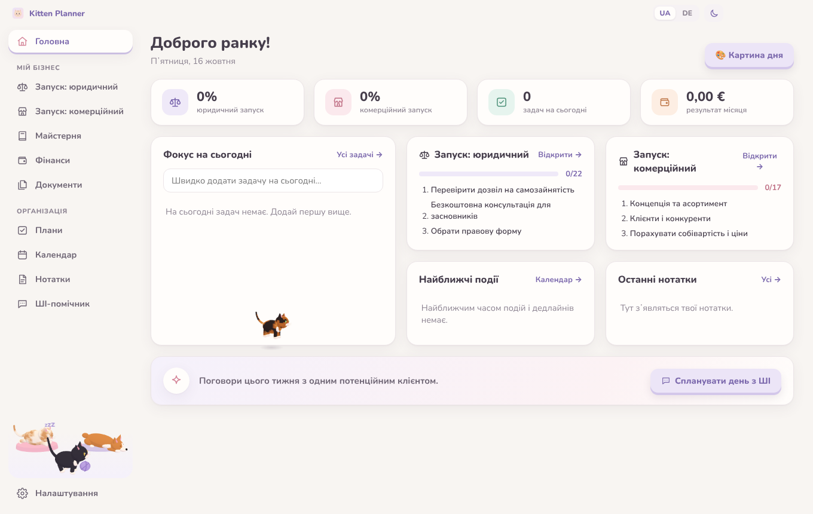
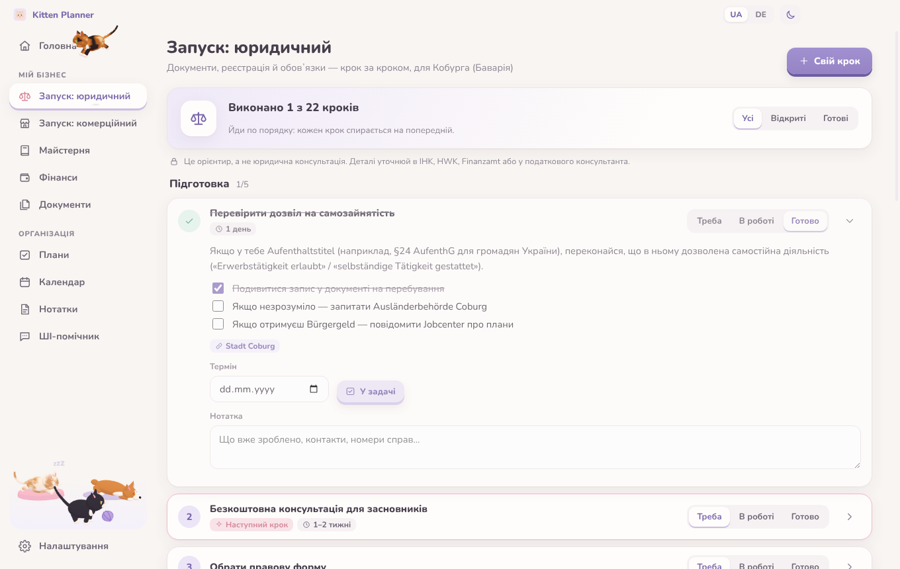
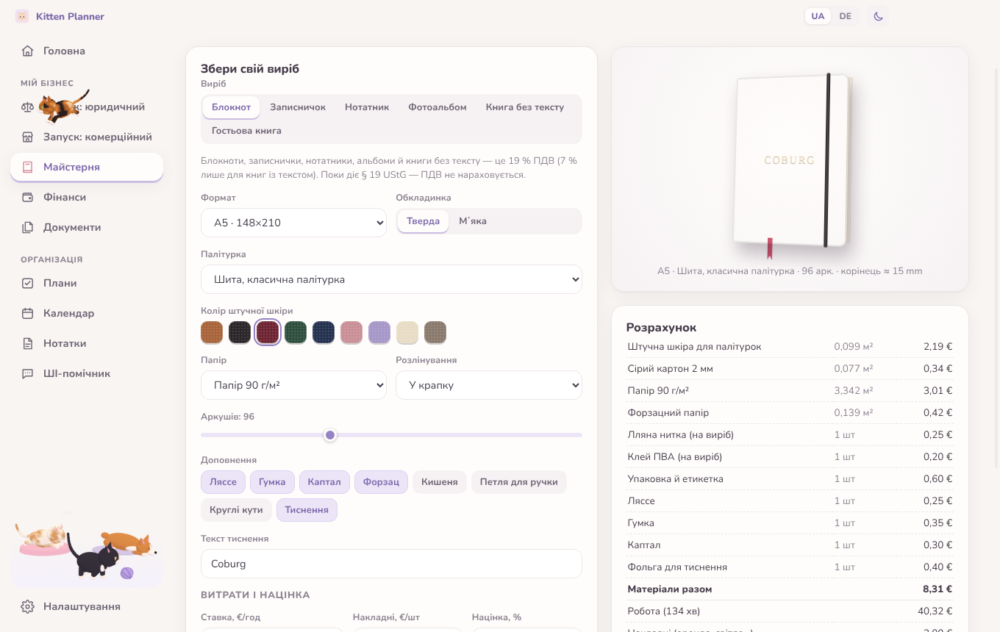
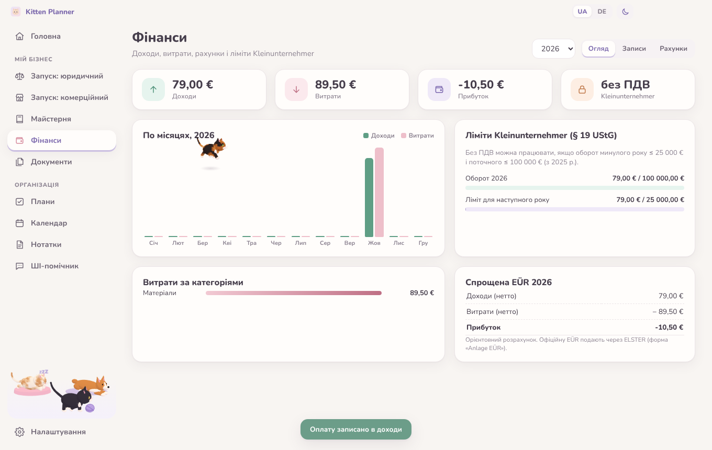
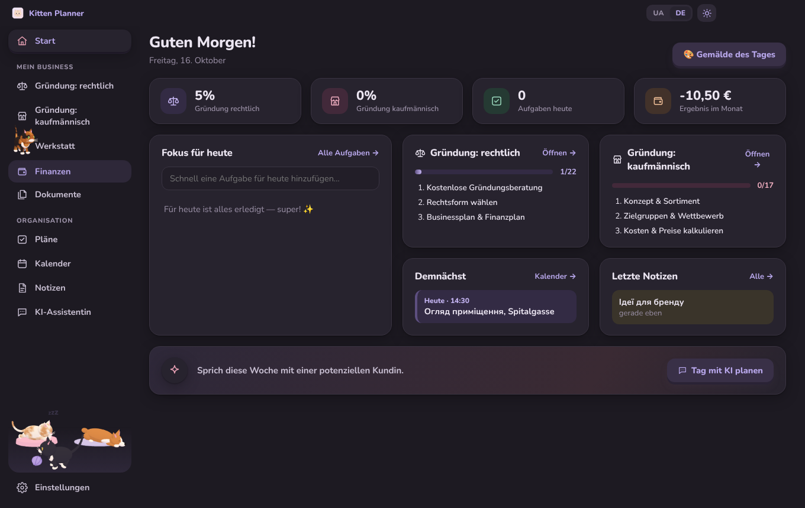

# Kitten Planner 🐾

A cozy but focused **Windows desktop workspace** for a founder opening a small
**bookbinding workshop & souvenir shop** (handmade faux-leather notebooks and books) in
the old town of **Coburg, Bavaria**. It bundles a step-by-step launch roadmap for German
bureaucracy, a notebook configurator with cost & price calculation, simple bookkeeping
with invoice PDFs, a document archive, a planner with a **painting-of-the-day** calendar, a ChatGPT
assistant with a little robot named **Auerilus** — and a **3D kitten** that follows your cursor,
naps, purrs and jumps onto the buttons you are about to click.

The interface is in **Ukrainian** with a one-click switch to **German**, in a light or dark theme.
All data stays **on the local machine**.



## Features

| Section                      | What it does                                                                                                                                                                                                                                                                                                                                                                                                                                                                                                                                                                                      |
| ---------------------------- | ------------------------------------------------------------------------------------------------------------------------------------------------------------------------------------------------------------------------------------------------------------------------------------------------------------------------------------------------------------------------------------------------------------------------------------------------------------------------------------------------------------------------------------------------------------------------------------------------- |
| **Launch: legal**            | 23 ordered steps for opening a business in Coburg: residence-permit check, founder consulting (IHK / HWK Oberfranken), legal form, _Gewerbeanmeldung_, _Handwerkskammer_ registration (bookbinding is a licence-free craft, HwO Annex B1), _Finanzamt_ questionnaire & _Kleinunternehmer_ rule, _Berufsgenossenschaft_, lease checks, signage permits, TSE cash register, GPSR labelling, online-shop duties (LUCID, imprint, GDPR), taxes. Each step has a checklist, official links, due date, notes and a status.                                                                              |
| **Launch: commercial**       | 17 steps tailored to the niche: concept & assortment, target groups (tourists, students, weddings), premises in the old town, tools & materials for faux-leather bookbinding, souvenir suppliers, fit-out, branding, website/social media, local partners, opening.                                                                                                                                                                                                                                                                                                                               |
| **Workshop**                 | **Configurator** for notebooks, pocket notebooks, notepads, photo albums, blank books and guest books (format, binding, cover, leather colour, paper, ruling, extras, embossing) with a live CSS preview, material breakdown, labour, overhead, markup, VAT / §19 and a suggested retail price ending in ,90. Products go into a **catalog** with stock; material prices are editable.                                                                                                                                                                                                            |
| **Finance**                  | Income/expense records with VAT rates, monthly chart, expenses by category, simplified EÜR, _Kleinunternehmer_ limit tracker (25 k€ / 100 k€), CSV export for the tax advisor, **invoices** with all §14 UStG fields rendered to **PDF** (paid invoices are booked automatically).                                                                                                                                                                                                                                                                                                                |
| **Documents**                | Local archive of business paperwork with categories, search, attached files (copied into the app data folder) and deadline reminders that also appear on the dashboard and calendar.                                                                                                                                                                                                                                                                                                                                                                                                              |
| **Plans · Calendar · Notes** | Goal-based task lists with progress, month calendar with events and deadlines from all sections, notes with colours, pinning and search.                                                                                                                                                                                                                                                                                                                                                                                                                                                          |
| **AI assistant**             | Two modes: sign in to your own **ChatGPT account** inside the app (an isolated, persistent browser partition limited to chatgpt.com and its login providers), or use the OpenAI API with your own key (stored encrypted via Windows DPAPI, optional business context, answers can be saved as notes). The robot **Auerilus** lives in a little playground next to the chat and plays tag with the kitten.                                                                                                                                                                                         |
| **Painting of the day**      | Every calendar day from October 2026 to the end of 2027 hides an easter egg: one of ~470 famous paintings (Old Masters to early modernism) with a bilingual story — style, how and where it was painted, its history and where it hangs today. Holidays and artists' birthdays get fitting pieces. Images are downloaded from Wikimedia Commons at build time (public-domain works only) and bundled into the `.exe`.                                                                                                                                                                             |
| **3D kitten**                | A small tortoiseshell toon kitten (three.js, built from primitives): calmly follows the cursor without getting in the way, **jumps onto the button you hover** while deciding where to go, falls asleep when the mouse rests, purrs with hearts when petted and plays with Auerilus in the AI tab. Never blocks clicks; falls back to a flat SVG kitten without WebGL. At the bottom of the sidebar a **pet corner** shows two more cats — Sefirka asleep on her cushion and tuxedo Gudsyk chasing a ball of yarn — and Bublyk the corgi dozing on his mat, who wakes up and wags when you hover. |

|                                                     |                                                         |
| --------------------------------------------------- | ------------------------------------------------------- |
|  |               |
|             |  |

## Download

Grab `KittenPlanner-<version>-portable.exe` from **Releases**, or the `KittenPlanner-windows`
artifact of the latest **Build** workflow run. It is a portable app: no installation, just run it.
The build is not code-signed, so Windows SmartScreen asks once (_More info → Run anyway_).

Data lives in `%APPDATA%\Kitten Planner` (`data.json` + `data.backup.json`, `documents/`, `secret.bin`).

## Tech stack

- **Electron** (sandboxed renderer, context isolation, strict CSP, single preload bridge)
- Vanilla **ES modules**, HTML & CSS — no framework, no bundler
- **three.js** for the kitten, **marked** + **DOMPurify** for chat markdown, **Nunito** font bundled
- **electron-builder** → single portable `.exe`
- Tests: **node:test** (store, OpenAI streaming, price calculation, i18n completeness) and
  **Playwright** driving the real Electron app end-to-end (with screenshots)
- **GitHub Actions**: lint + format + unit + e2e on Linux, `.exe` build on `windows-latest`, release on `v*` tags

## Project structure

```
src/main/            Electron main process
  main.js            window, IPC (data, chat streaming, PDF, documents, theme)
  store.js           JSON store with atomic writes + backup, schema normalisation
  secrets.js         OpenAI key encrypted with safeStorage (DPAPI)
  openai.js          streaming Chat Completions client (SSE)
src/renderer/
  index.html, css/   shell, design tokens (light/dark), components
  js/app.js          boot + view registration;  app-shell.js  nav, language & theme switches
  js/i18n.js         t() helper;  locales/uk.js, locales/de.js
  js/data/           launch roadmap content (uk + de)
  js/calc.js         notebook cost/price calculation (pure, unit-tested)
  js/invoice-template.js   German invoice HTML for PDF export
  js/kitten.js       kitten behaviour;  kitten3d.js (three.js), kitten-svg.js (fallback)
  js/robot3d.js      Auerilus;  playground.js  kitten + robot game;  gpt-host.js  ChatGPT webview
  js/data/art/       painting-of-the-day entries (uk + de), schedule and pinned dates
scripts/fetch-art.js resolves painting images via the Wikipedia API and bundles them
  js/views/          one module per section
test/unit, test/e2e  node:test and Playwright suites
```

## Development

```bash
npm install
npm start                          # run the app (npm run dev opens DevTools)
npm run check                      # ESLint + Prettier + unit tests
xvfb-run -a npx playwright test    # end-to-end (Linux); SCREENSHOT_DIR=dir saves screenshots
npm run dist:win                   # build the portable .exe (on Windows)
```

## Disclaimer

The launch roadmaps are practical guidance compiled from official sources (IHK, HWK, ELSTER,
BayernPortal, etc.), not legal or tax advice. Rules change — always confirm details with the
responsible authority or a tax advisor.

## License

MIT
