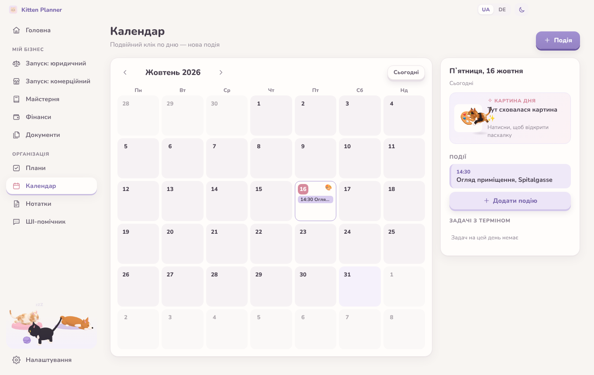
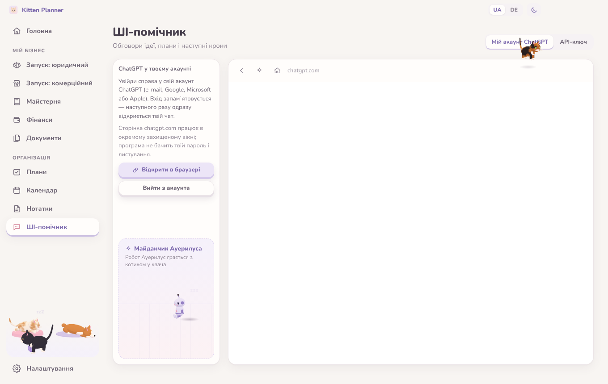
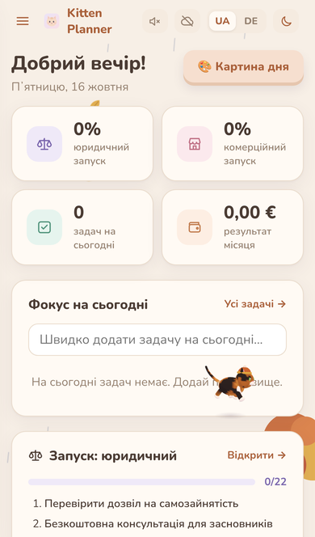
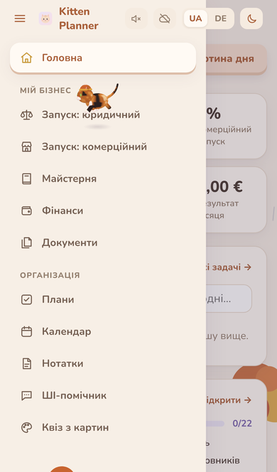
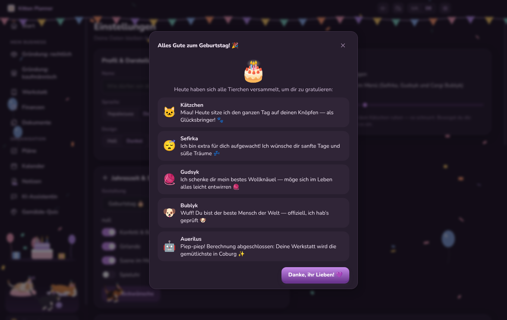
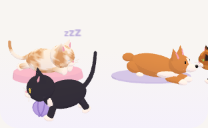
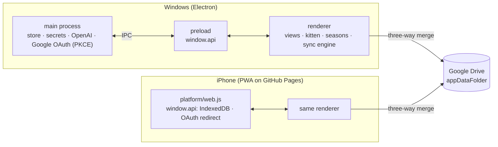

# Kitten Planner 🐾

[](https://github.com/kunstler-dev/kitten-planner/actions/workflows/build.yml)
[](https://github.com/kunstler-dev/kitten-planner/releases/latest)
[](LICENSE)
-blue>)
[](https://kunstler-dev.github.io/kitten-planner/)

A cozy but focused **Windows desktop workspace** for a founder opening a small
**bookbinding workshop & souvenir shop** (handmade faux-leather notebooks and books) in
the old town of **Coburg, Bavaria**. It bundles a step-by-step launch roadmap for German
bureaucracy, a notebook configurator with cost & price calculation, simple bookkeeping
with invoice PDFs, a document archive, a planner with a **painting-of-the-day** calendar, a ChatGPT
assistant with a little robot named **Auerilus** — and a **3D kitten** that follows your cursor,
naps, purrs and jumps onto the buttons you are about to click.

The same code also runs on the **phone** as an installable web app, and both devices stay in sync
through the user's **own Google Drive** — no server in between.
The interface is in **Ukrainian** with a one-click switch to **German**, in a light or dark theme,
with seasonal looks (autumn rain and falling leaves, Halloween, Christmas, spring, summer).

**▶ Try it in the browser: https://kunstler-dev.github.io/kitten-planner/** (data stays in your browser)


## Highlights

- **One codebase, two platforms.** The Electron renderer is plain ES modules; on the phone the same files
  are served from GitHub Pages and a browser implementation of the preload API (`window.api`: IndexedDB,
  downloads, print-to-PDF, OAuth redirect) is swapped in at boot. No framework, no bundler.
- **Serverless sync with a real merge.** Data lives in Drive's hidden `appDataFolder`; every sync is a
  pure, unit-tested **three-way merge** (per record and per field) against the last synced snapshot, so
  offline edits on both devices are combined instead of overwritten.
- **Security by default.** Sandboxed renderer with context isolation and a strict CSP, a single preload
  bridge, OAuth with PKCE on the desktop, API key and refresh token encrypted with `safeStorage`, path
  validation for stored documents, OAuth client ids and personal data injected from CI secrets.
- **Tested end to end.** Unit tests (`node:test`) for the store, merge, pricing, seasons and i18n
  completeness; Playwright drives the real Electron app and the phone build (iPhone viewport, faked Drive).
  CI builds the Windows `.exe`, publishes releases and deploys the phone version.
- **Made with love.** A three.js kitten that jumps onto the button you are about to press, a robot
  playing tag with it, a pet corner, ~470 paintings with stories and a quiz about them.

## Features

| Section                      | What it does                                                                                                                                                                                                                                                                                                                                                                                                                                                                                                                                                                                      |
| ---------------------------- | ------------------------------------------------------------------------------------------------------------------------------------------------------------------------------------------------------------------------------------------------------------------------------------------------------------------------------------------------------------------------------------------------------------------------------------------------------------------------------------------------------------------------------------------------------------------------------------------------- |
| **Launch: legal**            | 23 ordered steps for opening a business in Coburg: residence-permit check, founder consulting (IHK / HWK Oberfranken), legal form, _Gewerbeanmeldung_, _Handwerkskammer_ registration (bookbinding is a licence-free craft, HwO Annex B1), _Finanzamt_ questionnaire & _Kleinunternehmer_ rule, _Berufsgenossenschaft_, lease checks, signage permits, TSE cash register, GPSR labelling, online-shop duties (LUCID, imprint, GDPR), taxes. Each step has a checklist, official links, due date, notes and a status.                                                                              |
| **Launch: commercial**       | 17 steps tailored to the niche: concept & assortment, target groups (tourists, students, weddings), premises in the old town, tools & materials for faux-leather bookbinding, souvenir suppliers, fit-out, branding, website/social media, local partners, opening.                                                                                                                                                                                                                                                                                                                               |
| **Workshop**                 | **Configurator** for notebooks, pocket notebooks, notepads, photo albums, blank books and guest books (format, binding, cover, leather colour, paper, ruling, extras, embossing) with a live CSS preview, material breakdown, labour, overhead, markup, VAT / §19 and a suggested retail price ending in ,90. Products go into a **catalog** with stock; material prices are editable.                                                                                                                                                                                                            |
| **Finance**                  | Income/expense records with VAT rates, monthly chart, expenses by category, simplified EÜR, _Kleinunternehmer_ limit tracker (25 k€ / 100 k€), CSV export for the tax advisor, **invoices** with all §14 UStG fields rendered to **PDF** (paid invoices are booked automatically).                                                                                                                                                                                                                                                                                                                |
| **Documents**                | Local archive of business paperwork with categories, search, attached files (copied into the app data folder) and deadline reminders that also appear on the dashboard and calendar.                                                                                                                                                                                                                                                                                                                                                                                                              |
| **Plans · Calendar · Notes** | Goal-based task lists with progress, month calendar with events and deadlines from all sections, notes with colours, pinning and search.                                                                                                                                                                                                                                                                                                                                                                                                                                                          |
| **AI assistant**             | Two modes: sign in to your own **ChatGPT account** inside the app (an isolated, persistent browser partition limited to chatgpt.com and its login providers), or use the OpenAI API with your own key (stored encrypted via Windows DPAPI, optional business context, answers can be saved as notes). The robot **Auerilus** lives in a little playground next to the chat and plays tag with the kitten.                                                                                                                                                                                         |
| **Painting of the day**      | Every calendar day from October 2026 to the end of 2027 hides an easter egg: one of ~470 famous paintings (Old Masters to early modernism) with a bilingual story — style, how and where it was painted, its history and where it hangs today. Holidays and artists' birthdays get fitting pieces. Images are downloaded from Wikimedia Commons at build time (public-domain works only) and bundled into the `.exe`.                                                                                                                                                                             |
| **Seasons**                  | Automatic by date or chosen by hand: autumn (rain, trees dropping leaves), Halloween, Christmas (snow, garland, a small tree), winter, spring and summer — each with its own colour grading for both themes, canvas effects behind the UI, 3D hats for the pets and optional synthesised ambience (WebAudio, off by default). A birthday look with a greeting from all the pets.                                                                                                                                                                                                                  |
| **Painting quiz**            | "Who painted it?" and "Which one is theirs?" over the whole painting collection, with streaks and a synced best score.                                                                                                                                                                                                                                                                                                                                                                                                                                                                            |
| **3D kitten**                | A small tortoiseshell toon kitten (three.js, built from primitives): calmly follows the cursor without getting in the way, **jumps onto the button you hover** while deciding where to go, falls asleep when the mouse rests, purrs with hearts when petted and plays with Auerilus in the AI tab. Never blocks clicks; falls back to a flat SVG kitten without WebGL. At the bottom of the sidebar a **pet corner** shows two more cats — Sefirka asleep on her cushion and tuxedo Gudsyk chasing a ball of yarn — and Bublyk the corgi dozing on his mat, who wakes up and wags when you hover. |

|                                                                     |                                                         |
| ------------------------------------------------------------------- | ------------------------------------------------------- |
|                  |               |
|                             |  |
|  |     |

| Phone                                                          | Phone menu                                                               | Birthday greeting                                                             |
| -------------------------------------------------------------- | ------------------------------------------------------------------------ | ----------------------------------------------------------------------------- |
|  |  |  |

<p align="center"></p>

## Architecture



## Download

Grab `KittenPlanner-<version>-portable.exe` from the [latest release](https://github.com/kunstler-dev/kitten-planner/releases/latest), or the `KittenPlanner-windows`
artifact of the latest **Build** workflow run. It is a portable app: no installation, just run it.
The build is not code-signed, so Windows SmartScreen asks once (_More info → Run anyway_).

Data lives in `%APPDATA%\Kitten Planner` (`data.json` + `data.backup.json`, `documents/`, `secret.bin`).

## Phone & sync

The same app runs on the phone as an installable web app:
**https://kunstler-dev.github.io/kitten-planner/** — on an iPhone open it in Safari and choose
_Share → Add to Home Screen_. It starts like a native app, works offline and keeps its data on the phone.

Computer and phone share their data through the user's **own Google Drive** (Settings → Sync):

- Only the `drive.appdata` scope is requested — a hidden folder that belongs to the app; nothing else in
  Drive is visible to it. There is no server in between.
- Sync is a **three-way merge** against the last synced snapshot, per record and per field, so edits
  made offline on both devices are combined instead of overwriting each other (an edit beats a deletion).
- Theme, language and the kitten settings stay per device; the OpenAI key is never synced.
- Document attachments are uploaded too and downloaded on the other device when first opened.
- Desktop: OAuth for installed apps (system browser, loopback redirect, PKCE), refresh token encrypted
  with `safeStorage`. Phone: implicit-flow redirect (popups are unreliable in iOS home-screen apps); the
  hour-long token is renewed with a silent redirect on the next launch.

Setting it up needs a Google Cloud OAuth client — see [docs/google-sync.md](docs/google-sync.md).

## Secrets & personal data

Nothing private is committed. Build-time values come from repository secrets:

| Secret                                                     | Used for                                                                                        |
| ---------------------------------------------------------- | ----------------------------------------------------------------------------------------------- |
| `GOOGLE_WEB_CLIENT_ID`                                     | phone sign-in (written into the Pages build)                                                    |
| `GOOGLE_DESKTOP_CLIENT_ID`, `GOOGLE_DESKTOP_CLIENT_SECRET` | desktop sign-in (`scripts/google-config.js` → `src/google-config.json`)                         |
| `PERSONAL_CONFIG`                                          | birthday date and greeting words (`scripts/personal-config.js` → `src/renderer/js/personal.js`) |

`PERSONAL_CONFIG` is JSON: `{ "birthday": "MM-DD", "title": { "uk": "…", "de": "…" }, "love": { "uk": "…", "de": "…" } }`.
Without it the app uses neutral placeholders (no automatic birthday, generic greeting).

## Tech stack

- **Electron** (sandboxed renderer, context isolation, strict CSP, single preload bridge)
- Vanilla **ES modules**, HTML & CSS — no framework, no bundler
- **three.js** for the kitten, **marked** + **DOMPurify** for chat markdown, **Nunito** font bundled
- **electron-builder** → single portable `.exe`
- Tests: **node:test** (store, OpenAI streaming, price calculation, i18n completeness) and
  **Playwright** driving the real Electron app and the phone build (iPhone viewport, faked Google Drive) end-to-end
- **GitHub Actions**: lint + format + unit + e2e on Linux, `.exe` build on `windows-latest`, release on `v*` tags
  or a manual run, phone version deployed to **GitHub Pages**

## Project structure

```
src/main/            Electron main process
  main.js            window, IPC (data, chat streaming, PDF, documents, theme)
  store.js           JSON store with atomic writes + backup, schema normalisation
  secrets.js         OpenAI key encrypted with safeStorage (DPAPI)
  openai.js          streaming Chat Completions client (SSE)
src/renderer/
  index.html, css/   shell, design tokens (light/dark), components
  js/app.js          boot + view registration;  app-shell.js  nav, language & theme switches
  js/i18n.js         t() helper;  locales/uk.js, locales/de.js
  js/data/           launch roadmap content (uk + de)
  js/calc.js         notebook cost/price calculation (pure, unit-tested)
  js/invoice-template.js   German invoice HTML for PDF export
  js/kitten.js       kitten behaviour;  kitten3d.js (three.js), kitten-svg.js (fallback)
  js/robot3d.js      Auerilus;  playground.js  kitten + robot game;  gpt-host.js  ChatGPT webview
  js/data/art/       painting-of-the-day entries (uk + de), schedule and pinned dates
  js/sync/           Google Drive client, three-way merge, sync engine (shared by desktop and phone)
  js/platform/       browser implementation of window.api for the phone (IndexedDB, OAuth redirect)
  js/seasons/        season rules (pure), canvas effects, WebAudio ambience, birthday greeting
  js/personal.js     placeholders for personal data, filled from a secret in CI
  js/views/          one module per section (incl. quiz.js)
src/main/google.js   Google sign-in for the desktop (loopback + PKCE)
scripts/fetch-art.js resolves painting images via the Wikipedia API and bundles them
scripts/build-web.js builds the phone version into site/ (manifest, service worker) for GitHub Pages
test/unit, test/e2e  node:test and Playwright suites
```

## Development

```bash
npm install
npm start                          # run the app (npm run dev opens DevTools)
npm run check                      # ESLint + Prettier + unit tests
xvfb-run -a npx playwright test    # end-to-end (Linux); SCREENSHOT_DIR=dir saves screenshots
npm run dist:win                   # build the portable .exe (on Windows)
```

## Disclaimer

The launch roadmaps are practical guidance compiled from official sources (IHK, HWK, ELSTER,
BayernPortal, etc.), not legal or tax advice. Rules change — always confirm details with the
responsible authority or a tax advisor.

## License

MIT
